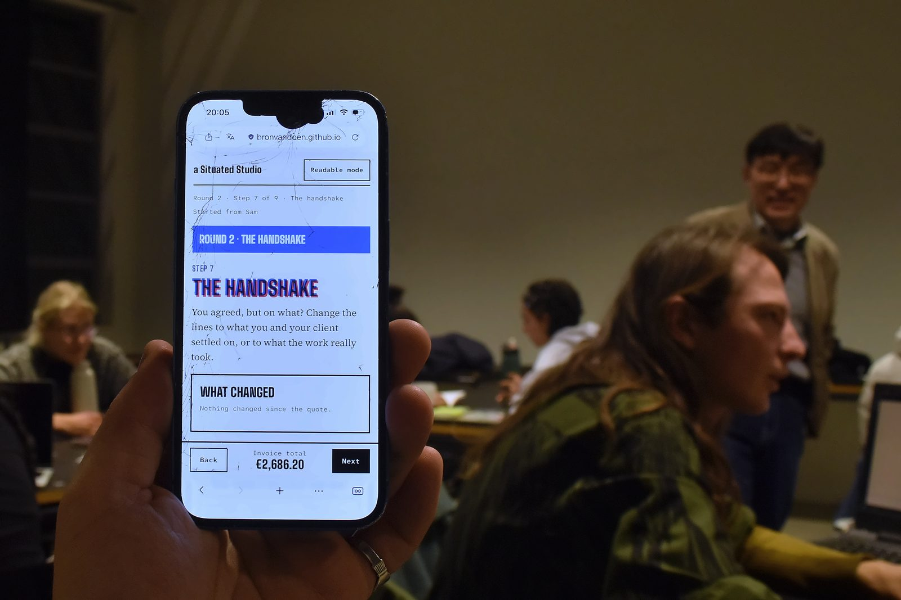
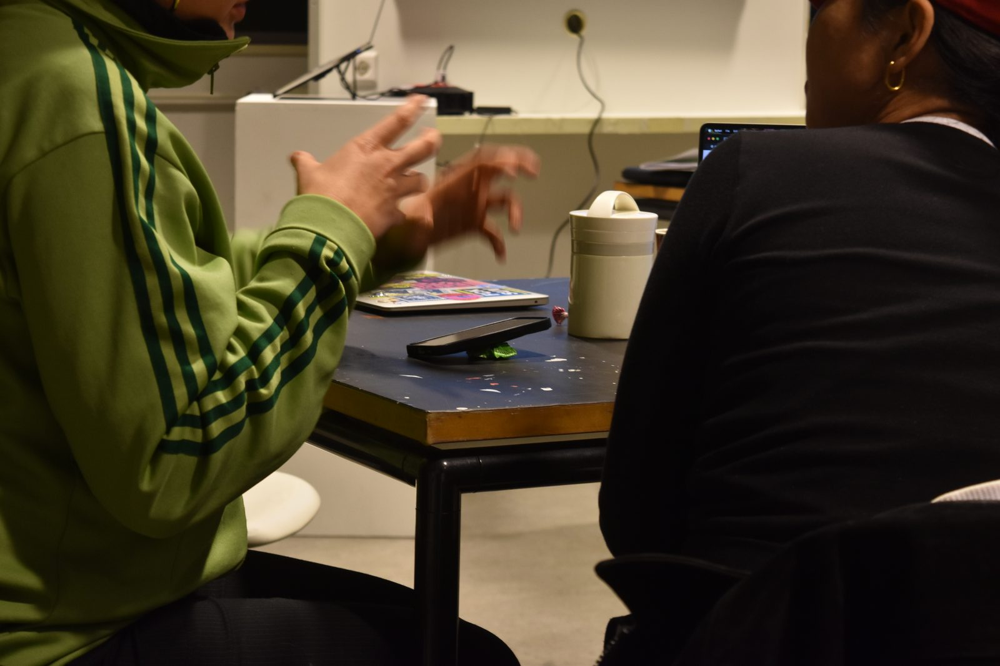

On Tuesday 3 November we ran the first evening of Economic Cultures at Design Academy Eindhoven, with Ned Kaar, DAE Alumni Coordinator. Two modules: My hourly rate, then From quote to invoice. This is a brief recollection of that evening, also for those who weren't there.

## The tools gave us time

Participants built an hourly rate from their own lives on their phones, then wrote a quote, negotiated it with a partner playing the client, and turned it into an invoice. Since the tools carried the steps, we earned much more time to engage in the discussions, and the room used it. The conversation we had planned for the end of the evening happened along the way, more organically. We could focus on what's important rather than on templates and calculators.

## Searching for standards

Ned put it simply afterwards: participants "really are searching for standards, something to root themselves to", while knowing how different their practices are. What the evening showed is that nobody hands those standards over. There is policy and advice to orient by, but nobody tells you how to price. It is "something that you need to be active and present" in, as Ned said, "not able to be handed to you on a platter".

Nobody felt out of place, either. Some came in saying they could finally think about this now.

## Rehearsing the negotiation

The negotiation was where the practice mattered most. Some pairs had, in Ned's words, "a lovely conversation. Way too lovely": they sensed something wasn't right, but didn't know where the silence in a negotiation should fall. That is exactly why we rehearse. Not to learn one vocabulary, but to get used to there being different ones, and to try them out. As Ned said, "the rehearsal of it is extremely important."

## Where to go for help

In the talk about the unspoken rules, two places came up that weren't on our slides: the Juridisch Loket for free legal advice, and the Kunstenbond, the union for culture. Ned reminded us how new this is for many: most have never thought about a union, or where to go when something goes wrong. The support is there, "but the burden of seeking it out is yours". We have added this information to the slides after the evening, with the BNO, and wrote out the known steps for an unpaid invoice as a working note.

## Next

On Thursday we budget a project of our own, and we plan to be more proactive in introducing Seeds of Hope: cases from artistic and social practice that think differently about economic systems. "They are funny, they are destructive, they are lovely", Gemma said, "beautiful stories about the other ways of economy." Next to them we bring the Fair Practice Code and a few quotes from Bianca Elzenbaumer's *Designing Economic Cultures*.

## Resources

### From the evening

- [Module 1: My hourly rate, the slides](/entries/economic-cultures-module-1-2026-11-03/)
- [Module 2: From quote to invoice, the slides](/entries/economic-cultures-module-2-2026-11-03/)
- [My hourly rate, the tool](/tools/economic-cultures/hourly-rate/)
- [From quote to invoice, the tool](/tools/economic-cultures/quote-invoice/)
- [Giving the money a name](/entries/giving-the-money-a-name/), Gemma's story from Module 1
- [When the invoice isn't paid](/entries/when-the-invoice-isnt-paid/), the known steps, not legal advice
- [Fair Practice Code: ten questions to ask yourself](/entries/fair-practice-code-ten-themes/), our English handout
- [The blind quote](/entries/the-blind-quote/), why a client who hides the budget is the one with the poor practice

### Starting out

- [business.gov.nl](https://business.gov.nl/), starting as a sole proprietor, in English
- [KvK](https://www.kvk.nl/en/), the Chamber of Commerce, where you register
- [Belastingdienst](https://www.belastingdienst.nl/), what changes for your taxes when you start
- [IND](https://ind.nl/en), from outside the EU: whether your permit allows self-employment

### Fair practice and support

- [Fair Practice Code](https://fairpracticecode.nl/)
- [Kunstenbond](https://kunstenbond.nl/), the union for culture: legal help for members, first year free for students
- [BNO](https://www.bno.nl/), the association of Dutch designers: advice on contracts and terms for members
- [Juridisch Loket](https://www.juridischloket.nl/), free on a low income, for your personal situation or *schijnzelfstandigheid*
