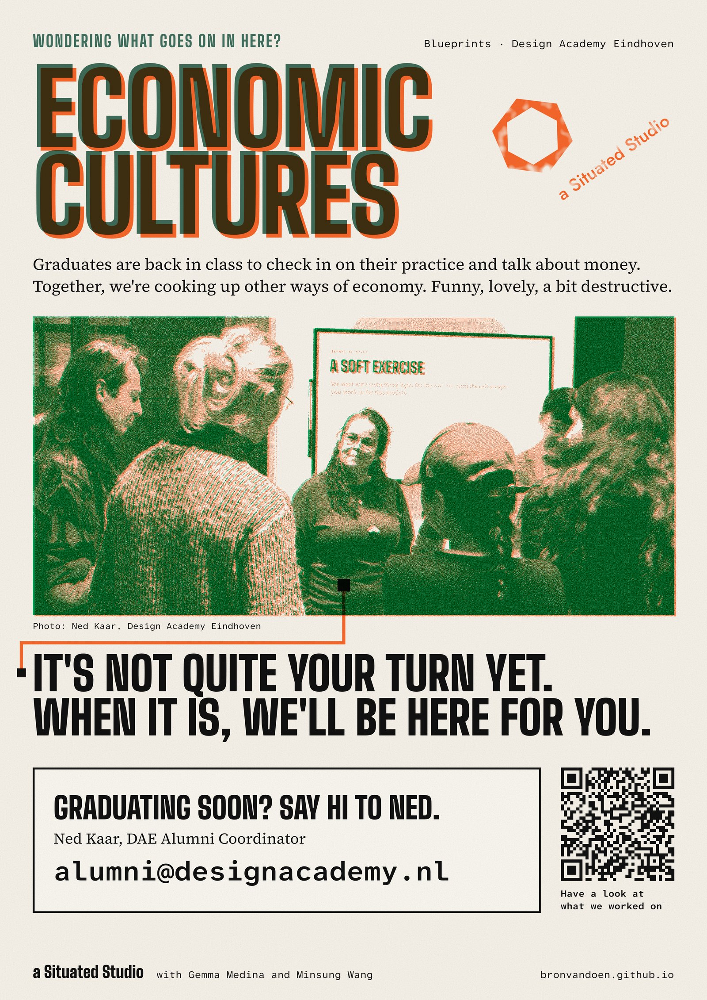

Economic Cultures is for graduates, past and present. This poster is for the ones still on their way: a wave from the door of Room 2A, a link to what we worked on, and who to write to when the time comes, Ned Kaar, DAE Alumni Coordinator. The same poster in two colour pairings, to print on A3.

[Download the A3 PDF, Teal + Fluo Pink](/prints/economic-cultures/poster-2026-11/economic-cultures-poster-teal-pink.pdf)

[Download the A3 PDF, Green + Orange](/prints/economic-cultures/poster-2026-11/economic-cultures-poster-green-orange.pdf)
