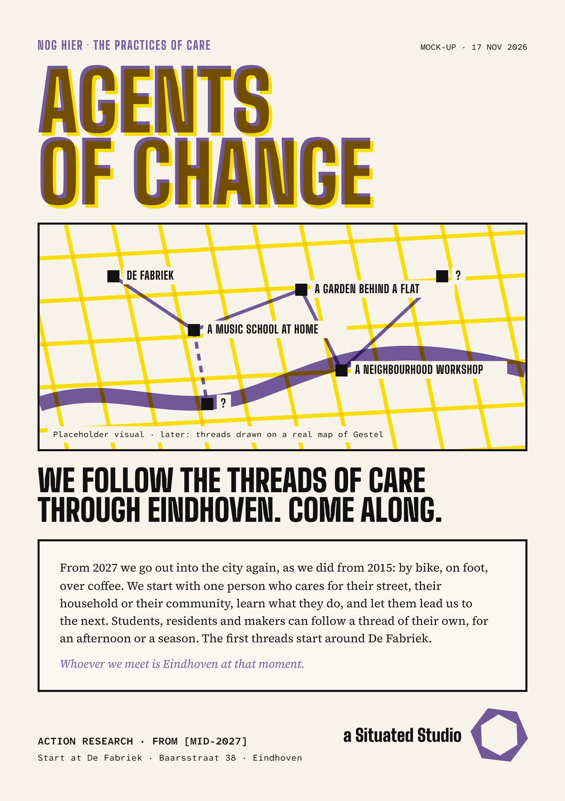
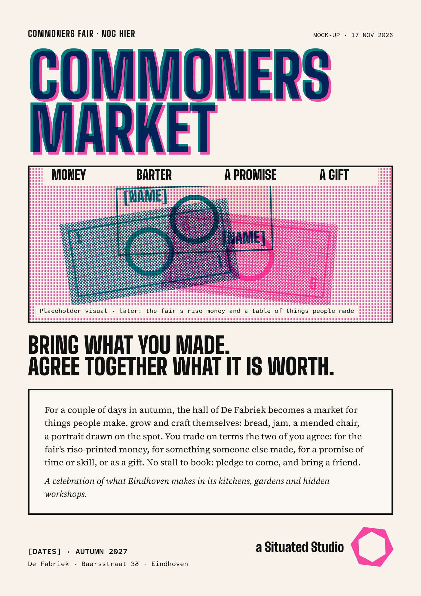
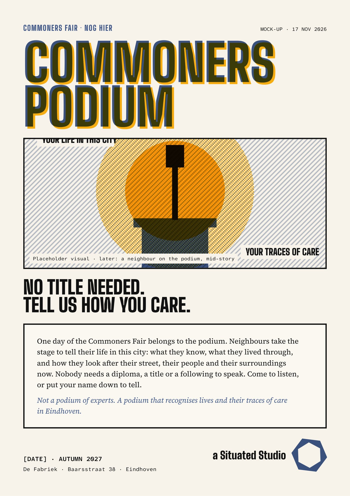
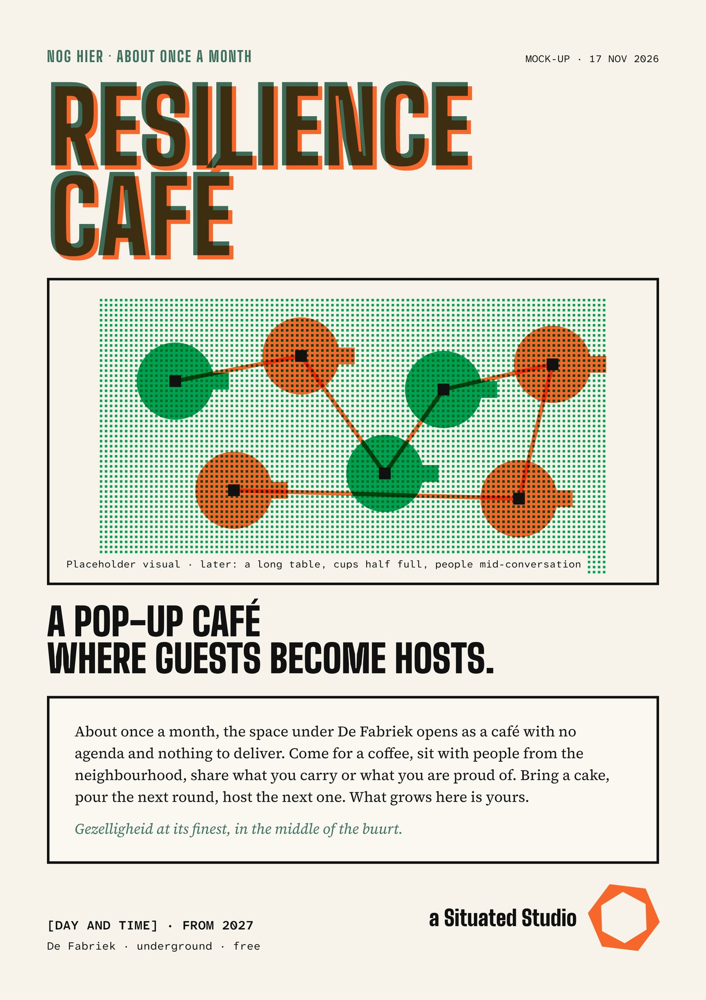

Four mock-ups, dated today. We made them for a catch-up with De Fabriek about *Nog Hier: the practices of care*, our next round of Agents of Change. They are also practice for us: saying in one poster what each part is, so that nobody has to ask how the market differs from a flea market. Dates are in brackets and the visuals are placeholders.

[Download all four as A3 PDF](/prints/agents-of-change/nog-hier-posters-2026-11-17/nog-hier-posters-2026-11-17.pdf)
